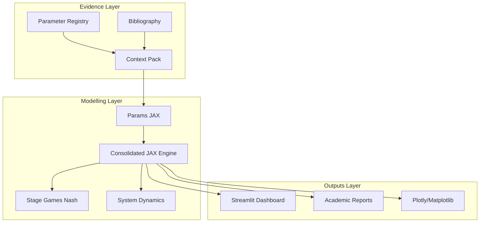

# design.md — Architecture, modelling approach, and evidence system

**Version:** Current
**Date:** 2025-12-30

## Overview

The repository is designed as a **model-based policy analysis** toolchain with three pillars:

1. **Evidence / Context layer** (public-only parameter grounding, provenance, checklists)
2. **Modelling layer** (stage games + system dynamics; optional stochasticity; deterministic checks)
3. **Outputs layer** (reports, plots, tables, diagrams; reproducible pipelines)

## Repo structure

- `src/nhra_gt/` — core model library
- `tests/` — unit + property-like tests; coverage enforced
- `context/` — project intent, policy questions, parameter registry, provenance, glossaries
- `scripts/` — runnable pipelines (versioned; avoid “magic” by keeping scripts thin)
- `outputs/` — generated tables/plots
- `reports/` — rendered narrative reports (MD + HTML)
- `diagrams/` — mermaid + graphviz sources and rendered figures

## Evidence and “public-only” constraint

### Parameter registry

`context/04_parameter_registry.csv` is the single source of truth for parameters.

Each parameter record includes:

- value and units,
- source type (`primary`, `secondary`, `calibrated`, `assumed`, `normalisation`),
- a **public URL** and locator (page/table/section),
- plausible range (low/high) and distribution (optional),
- justification (required for assumptions).

### Enforcement

`scripts/check_parameters_grounded.py` fails CI if:

- a parameter is labelled `primary` or `secondary` and lacks a public URL,
- an URL is not http/https,
- a parameter is `assumed` but justification is insufficiently detailed,
- range bounds are missing.

This ensures the model can be audited by external reviewers.

## Modelling approach

### 1) Stage games

A small set of two-player stage games represent strategic tensions, e.g.:

- definition (what counts as “efficient”),
- bargaining (cap/glide path),
- cost shifting,
- discharge coordination,
- governance integration (UCCs etc),
- compliance/audit incentives.

For each game, the code:

- constructs payoff matrices from state variables (pressure, efficiency gap, discharge delay),
- enumerates pure equilibria and checks for a full-support mixed witness for admitted 2×2 games,
- selects equilibria for simulation using a configurable rule (e.g., welfare, risk-dominant).

#### Solver boundaries

The eager two-player interface uses Paignia at
`cb35688c096a2200f51c0fc1dc8c079a7ffa50c9`. The mixed 2×2 path keeps NHRA’s
indifference cutoff and returns a verified interior witness in action order.
The asymmetric coordination fixtures check both players’ probabilities and
deviations. Singular games and boundary continua remain outside the scope of
this mixed witness.

For eager sequential decisions, the leader chooses a row and the follower
observes it before choosing a column. The native tree applies zero numeric
tolerance and preserves the first index at exact ties. The retained NumPy
path covers inputs outside the bounded binary64 profile. Compiled JAX
commitment uses the leader-favourable follower tie rule.

The UOGTO mapping reuses `https://w3id.org/uogto/core#NormalFormRepresentation`
for simultaneous payoffs and `https://w3id.org/uogto/core#ExtensiveFormRepresentation`
for the two-stage policy. Each follower decision has its own information set.
The static graph maps players to decision nodes and terminal payoffs.
[UOGTO vocabulary](https://github.com/edithatogo/UOGTO/tree/cc0c84201929996580bb4af98774cf2145b224ae)
[Static graph example](https://github.com/edithatogo/paignia/blob/dbc647c9943b43b7f49fb8c052063442424454b1/verification/uogto_interchange/game.ttl)

Logit QRE depends on the returned strategies’ fixed-point error and has its
own differentiable JAX path. The standalone alternating-offer calculation
uses an infinite horizon. Its equal split at perfect patience is a
historical endpoint convention. The `rubinstein` dispatch name in `solve_game`
remains a legacy alias for simultaneous Nash.

#### Two-player QRE admission

The compiled NHRA callers use the existing 100 updates from uniform play and
the inclusive `1e-6` residual tolerance. A profile is usable only when its
residual qualifies and the logit equilibrium at the requested rationality is
unique. The code proves uniqueness using a strict contraction bound on the
composed responses or, for binary games, responses with opposite directions.
When the residual passes and uniqueness cannot be established, the caller
reports `BRANCH_UNQUALIFIED`. This includes multiple-equilibrium games with
small residuals. Gambit continuation verifies the qualified branch in the
synthetic comparisons. [Gambit method](https://gambitproject.readthedocs.io/en/v16.7.0/algorithms.html#logit)

`HeuristicAgentJax.decide_with_diagnostics` returns the strategy vector and
residuals and statuses for definition, bargaining and cost shifting in that
order. The array-only `decide` keeps its shape. A rejected strategy vector
contains NaNs. A strategic `run_hybrid` run reports the first failed game,
rollout, month, status and residual before aggregating any trajectories.

`solve_constitutional_game_jax` returns the original four-array tuple,
including when used with JAX's four-output `vmap` axes. To read per-cell
`micro` and scalar `macro` diagnostics, call
`solve_constitutional_game_with_diagnostics_jax`. A failed
microgame leaves the macro solve `SKIPPED`. Any unqualified constitutional
solution withholds all four arrays as NaNs. A skipped macro residual is NaN.
An attempted solve always reports its original residual.

#### Three-player QRE admission

For three-player logit QRE, call
`solve_three_player_qre((payoffs_1, payoffs_2, payoffs_3))` from
`nhra_gt.solvers_jax` at the Python boundary. It reports the solver's residual
as a scalar. The result has status `converged` and carries the three strategy
vectors in seat order when the residual is between zero and `tol`, inclusive.
The default bound is `1e-6`. Other residuals, including nonfinite values, give
`nonconverged` with `strategies=None`. A caller can retain the residual for
diagnosis. Use `qre_3player_jax` inside JAX transformations to get the final
iterate and its residual.

### 2) System dynamics

A compact set of state variables evolve annually (or finer if needed), including:

- NEP index and input-cost index (publicly sourced where available),
- efficiency gap as cost-per-NWAU relative to NEP,
- pressure, discharge delay, and flow proxies.

The dynamics support:

- stochastic Monte Carlo runs (for robustness),
- deterministic mean-field and fixed-point checks (equation solving for stability).

The recursive historical backtest requires an observed occupancy series
alongside the four-hour ED measure. AIHW’s patient-day counts describe
episodes ending in the reporting period. A bed occupancy series needs aligned
overnight patient days and available overnight bed-days for the same hospitals
and financial years. The tracked normalized data currently supplies `year`
and `within4`.
[AIHW beds](https://www.aihw.gov.au/hospitals/topics/hospital-resources/public-hospital-beds)
[AIHW patient days](https://www.aihw.gov.au/hospitals/topics/admitted-patient-care/hospitalisations-and-patient-days)

## Outputs and reporting

### Reports

Reports are built from templates that:

- introduce each results section in full sentences,
- provide figure/table titles, captions, and abbreviations,
- include a synthesis paragraph per section and an overall conclusion.

### Diagrams

Diagrams are maintained in source form:

- `diagrams/*.mmd` (Mermaid)
- `diagrams/*.dot` (Graphviz)

Render scripts generate publication-ready PNG/SVG.

## Reproducibility and CI

- `Justfile` provides a consistent local interface.
- `Snakefile` provides a DAG for pipelines.
- `.github/workflows/ci.yml` runs:
  - lint/format, tests, coverage gates, grounding checks, context pack build.
